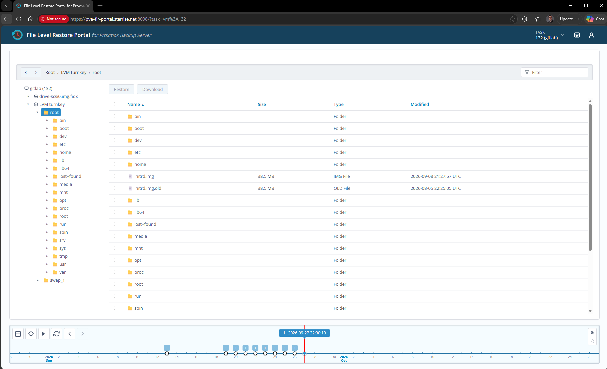

# File Level Restore Portal for Proxmox Backup Server (pve-flr-portal)

A small companion app for Proxmox VE + Proxmox Backup Server: a
scrubbable snapshot timeline and file browser for file-level restore,
in the spirit of Synology Active Backup for Business's restore portal.

Proxmox's own file-restore feature already does the hard part (safely
reading an arbitrary guest filesystem out of a backup via a throwaway
helper VM) — it's just missing a way to scrub across snapshots instead
of picking one at a time from a flat list. This project adds that on
top of Proxmox's existing API, without modifying Proxmox itself.



See [`docs/architecture.md`](docs/architecture.md) for the system
design, [`docs/api-reference.md`](docs/api-reference.md) for the PVE/QGA
API contracts this app depends on, and
[`docs/push-to-guest.md`](docs/push-to-guest.md) for the restore-to-guest
feature's mechanism. [`TODO.md`](TODO.md) covers open work, and
[`CHANGELOG.md`](CHANGELOG.md) what's shipped in each release.
Also check [GitHub issues](https://github.com/treycentric/pve-flr-portal/issues) for outstanding work items.

## Features
- Browse and download files and folders out of PBS backups (single file,
  or a `.zip`/`.tar.gz`/`.tar.zst` bundle)
- Scrub across a timeline to pick a snapshot to work with. This allows
  for quick comparisons of folder contents between two different
  snapshots.
- Authenticated using PVE login (password or SSO/OIDC). This app does not
  manage its own credentials. All authentication and authorization is
  controlled through PVE. See "Provisioning access" below for how to grant
  a user access.
- Light, dark, and Proxmox Dark color themes.
- Restore straight back into a running guest via `qemu-guest-agent`
  including single file, multiple files, and whole directories to the
  original location (auto-resolved from the item's own path) or to a
  location of the user's choosing (browse live guest drives and
  directories or manually type a path). Restoration supports a few
  different methods (support detected automatically):
  - Chunk method using qemu-guest-agent (slower). Useful for smaller
    content.
  - HTTP/HTTPS Direct Network Transfer path (faster). Preferable for
    larger content or lots of files/directories.
- Automatically resolves Windows drive-letter mapping to partitions for
  display in the UI, matched to the guest's real disk/partition layout.
- Supports the use of multiple PBS storage backends.
- Hides partitions automatically that aren't readable or don't contain
  supported filesystems. This also includes Windows striped/mirrored volumes.

See `CHANGELOG.md` for the version-by-version detail and `TODO.md` for
what's on the roadmap.

## Using the File Restore Portal

1. **Log in** with your own PVE username/password (realm dropdown,
   optional "save username").
2. **Task** (top right) picks which guest VM or container you're browsing — a
   filterable list of every guest with backups on the configured PBS
   datastores. You will only see the ones for which you have been granted the
   required roles via PVE.
3. **The timeline** (bottom) is one of the main benefits of the app: each
   dot is a snapshot; click one to select it (the callout jumps to it), drag
   to pan, use the zoom controls or click a callout with multiple snapshots
   to pick between them.
4. **Browse** the selected snapshot via the folder tree on the left or
   the breadcrumb bar above the file grid — both stay in sync with each
   other and with the timeline (switching snapshots keeps you in the
   same folder if it still exists there). Partitions, LVM volumes, and
   filesystem roots get their own icon, distinct from a plain folder;
   a Windows partition shows its live drive letter (e.g. "2 (C:)") when the
   guest agent can resolve it.
5. **Download** — select one file for a direct download, or select
   multiple files/folders (or a single folder) to get a "Download as"
   dropdown offering `.zip`, `.tar.gz`, or `.tar.zst`.
6. **Restore** writes the selection straight back into the *running*
   guest via `qemu-guest-agent`, instead of downloading it. The button
   is only enabled for guests where the agent is reachable and your PVE
   account holds the separate restore grant (see "Restore-to-guest"
   below); the confirmation modal dialog provides three options for
   picking the destination directory:
   - **Original location** (resolved automatically from the item's own path
   in the backup, when the app can confidently determine it)
   - **Browse**
   - Manually typed path
   Offers selectable options for "restore metadata" (modified time) and
   "verify" (checksum) when restoring a single file. Multi-file/directory
   restore already does both of those automatically (required).
   "Restore original owner/permissions" is offered either way (for Linux/BSD
   guests only - greyed out for Windows, since NTFS ACLs can't be recovered
   through any file-restore API Proxmox currently exposes; see
   "Restore-to-guest" below). Large transfers use a Direct Network Transfer
   path automatically when a data NIC is configured for the application.
7. **Restore Jobs** (top right) allows for viewing the progress of running
   or completed restore jobs.
8. **Color Theme** Change the currently selected color theme used by the app
   (stored in user's browser state).
9. **About** (user menu, top right) shows the running version and a
   link back to this repo.

## Running It Locally

```
git clone https://github.com/treycentric/pve-flr-portal.git
cd pve-flr-portal

python -m venv .venv
source .venv/Scripts/activate   # .venv/bin/activate on Linux/macOS
pip install -r requirements.txt

cp .env.example .env
# edit .env: fill in PVE_HOST/PVE_STORAGE for your environment
# (PVE_STORAGE takes several comma-separated ids if you back up to more
#  than one PBS storage/namespace)

python run.py
```

The app serves HTTPS by default on port **8008** (a self-signed cert is
generated automatically on first run at `certs/portal.crt`/`portal.key`
if you haven't dropped in your own). Open **https://127.0.0.1:8008/** —
your browser will warn about the self-signed cert the first time; that's
expected until you replace it. Drop a CA-issued cert/key at the same
paths to do so.

See "Provisioning access" below for how to grant a user the
`FileRestoreReader` role needed to browse and download (host backups and
restore-to-guest each need their own separate grant, also covered there).

## Provisioning Access

The portal never gets its own PVE credentials — every user logs in
with their own PVE username/password, and PVE's own permission system
decides what they can see. Onboarding a user is two ACL grants against
their existing account; no tokens or secrets to generate or hand off.

### Browse Backup Snapshots and Download Contents

Browsing and downloading only needs `FileRestoreReader` (created here).

**1. Create the role** (once, on the PVE node — skip if it already
exists):

```
pveum role add FileRestoreReader -privs "Datastore.AllocateSpace,VM.Backup,VM.Audit"
```

`Datastore.AllocateSpace` + `VM.Backup` are what PVE's file-restore API
actually requires to read a backup volume (`Datastore.Audit` alone is
not enough); `VM.Audit` lets the portal resolve guest names for display.
See `docs/api-reference.md` if you want the full "why" behind that specific
privilege set.

**2. Grant it to each user:**

```
pveum acl modify /storage/<storage-id> --users <user>@<realm> --roles FileRestoreReader
pveum acl modify /vms --users <user>@<realm> --roles FileRestoreReader
```

Replace `<storage-id>` with your PBS storage ID (matches `PVE_STORAGE`
in `.env`) and `<user>@<realm>` with the account (e.g. `alice@pam`,
`bob@ad`). Scope the second command to `/vms/<vmid>` instead of `/vms`
to limit which guests that user can see, rather than everything on the
datastore. If `PVE_STORAGE` lists several storages, run the first grant
once per storage id (or grant it on a parent path such as `/storage`) —
a storage a user has no access to is simply skipped, not an error.

**Equivalent GUI steps** (Datacenter → Permissions):
1. **Users** — confirm the account exists. Local `pve`-realm accounts
   need a password set here (`Datacenter → Permissions → Users → Edit`);
   PAM/LDAP/AD accounts just need their realm configured under
   `Datacenter → Realms`.
2. **Roles** — `Add` a role named `FileRestoreReader` and check
   `Datastore.AllocateSpace`, `VM.Backup`, `VM.Audit` (skip if the role
   already exists).
3. **Add → User Permission** — Path: `/storage/<storage-id>`, User: the
   account, Role: `FileRestoreReader`, Propagate: checked.
4. **Add → User Permission** (again) — Path: `/vms` (or a specific
   `/vms/<vmid>`), same User/Role, Propagate: checked.

### Browse Host Backups

**Requires a PVE-side patch first — this alone won't make host backups
appear, no matter how permissions are configured.** PVE's own
`PVE::Storage::PBSPlugin::list_volumes` drops `host`-type backups from
every storage content listing unconditionally, before any permission
check ever runs — even `root@pam` can't see one in
PVE's own GUI. There's no supported PVE API path around this. Run
`deploy/patch-pve-host-backups.sh` on every PVE node first (opt-in,
explained in full there and offered during `lxc-create.sh`) — only
once that's done does the rest of this section's permission setup
actually matter. See `docs/api-reference.md` for the full trace.

A `host`-type backup (`proxmox-backup-client backup --backup-type
host`, e.g. a PVE node backing up its own `/`, or any other machine
backed up the same way — PBS has no fourth "generic file-level backup"
type beyond `vm`/`ct`/`host`, this covers all of them) has no VM/CT
behind it to attach a per-guest permission to, so it needs a separate
role from `FileRestoreReader` — `Datastore.AllocateSpace` + `VM.Backup`
can never grant access to one, no matter how it's configured: PVE's
own `check_volume_access` only resolves an owning VM/CT id for `vm`/`ct`
backups, so a host backup's volume-access check falls straight through
to the one remaining path, `Datastore.Allocate` — full admin rights on
that storage (create/delete backups, modify the storage definition),
not a read-only grant. There is no narrower privilege in PVE's own
access-control model for this.

**PBS has its own, separate ACL system too.** The PVE storage entry
authenticates to PBS using its own stored PBS user/token (configured
when the storage was added) — that credential needs its own read
access on the PBS side to the namespace in question, independent of
anything granted in PVE. A PBS role like `DatastoreBackup` is
*ownership-scoped* — it only covers backups that same PBS identity
created — so if a different identity (e.g. a separate service account)
made the host backups, the PVE storage entry's own PBS credential
needs `DatastoreReader` (or broader) on that namespace too, granted on
PBS's own Permissions page, or it'll see nothing there either.

**Recommendation: give host backups their own PBS namespace (and PVE
storage entry), separate from any storage holding VM/CT backups.**
`Datastore.Allocate` is scoped to the whole storage entry, not to
individual backups within it — granting it on a storage that also
holds VM/CT backups would hand the same user admin rights (including
delete) over those too, far beyond what browsing host backups needs.
Datacenter → Storage → Add → Proxmox Backup Server, same server/
datastore as your existing PBS storage, with **Namespace** set to
wherever your host backups live, and a distinct storage id (e.g.
`pbs-host`) — then add that id to `PVE_STORAGE` in `.env`. If the host
backups are client-side encrypted with a key the portal's PVE account
needs decrypted access to, upload it on this same storage entry's
**Encryption Key** tab (`Edit` → `Encryption Key` → `Upload key`) — PVE
decrypts transparently during file-restore once the key is there,
whether or not PVE itself made the backup.

**This also unlocks host backups in PVE's own native "Backups" tab**,
including its own File Restore button — not just this app, since
`deploy/patch-pve-host-backups.sh` works by fixing what PVE itself
hands back, the same way regardless of caller. `Restore`,
`Show Configuration`, and `Change Protection` on a host backup's row in
PVE's GUI don't work correctly - PVE didn't design those for a backup
with no VM/CT behind it. `File Restore` is the one that matters and
it's fine. Fixing the other three would mean patching PVE's own
frontend to hide them for `host`-type rows specifically - out of scope
here; this is a known, accepted rough edge, not a bug to report.

**1. Create the role** (once, on the PVE node — skip if it already
exists):

```
pveum role add FileRestoreReaderHost -privs "Datastore.Allocate,Datastore.Audit"
```

`Datastore.Allocate` is what file-restore itself needs (above);
`Datastore.Audit` is needed separately — PVE's backup-listing endpoint
(what makes a backup show up in the portal at all) accepts
`Datastore.Audit` *or* `Datastore.AllocateSpace`, and `Allocate` isn't
either of those; they're independent privilege bits in PVE, not a
hierarchy (PVE's own built-in `PVEDatastoreAdmin`
role bundles all of them together rather than relying on
`Allocate` alone). See `docs/api-reference.md` for the full trace
through PVE's source.

**2. Grant it to each user:**

```
pveum acl modify /storage/<host-storage-id> --users <user>@<realm> --roles FileRestoreReaderHost
```

Replace `<host-storage-id>` with the dedicated host-backup storage id
from the recommendation above (not your general VM/CT storage) — this
is the one grant `Datastore.Allocate`'s blast radius makes worth
keeping storage-scoped rather than widened to a parent path.

**Equivalent GUI steps** (Datacenter → Permissions):
1. **Roles** — `Add` a role named `FileRestoreReaderHost` and check
   `Datastore.Allocate`, `Datastore.Audit` (skip if the role already
   exists).
2. **Add → User Permission** — Path: `/storage/<host-storage-id>`,
   User: the account, Role: `FileRestoreReaderHost`, Propagate: checked.

### Restore to Guest

Restoring a file directly back into a *running* guest via
`qemu-guest-agent` (see `docs/push-to-guest.md`) is a **separate,
deliberate** grant — a user who can browse a backup should not
automatically be able to write into the live guest. It's never folded
into `FileRestoreReader`.

**Requires PVE 9+.** These are granular `VM.GuestAgent.*` privileges;
PVE 8 only has the coarse, all-or-nothing `VM.Monitor` and can't scope
this feature tightly, so it stays unavailable on PVE 8 regardless of
any role/ACL setup.

**1. Create the role** (once, on the PVE node — skip if it already
exists):

```
pveum role add FileRestoreOperator -privs "VM.GuestAgent.Audit,VM.GuestAgent.FileWrite"
```

- `VM.GuestAgent.Audit` lets the portal ask the guest agent what it
  supports (capability detection) — grant it alongside either of the
  other two below, not on its own.
- `VM.GuestAgent.FileWrite` enables **quick restore**: small files
  written straight into the guest, landing `root:root`/SYSTEM with a
  fresh mtime. `agent/file-write` has no mode parameter and qemu-ga
  creates new files `0666`, so on Linux/BSD guests the portal follows up
  with a `chmod go-w` (`0644`) when `VM.GuestAgent.Unrestricted` is also
  granted; with FileWrite alone the file stays `0666` and the job log
  says so. (Windows files inherit their folder's ACL.)
- `VM.GuestAgent.Unrestricted` enables **full restore**: larger files,
  directories, and the optional "restore metadata" / "verify"
  upgrades. This is a much larger grant — Proxmox doesn't expose a
  narrower privilege for `guest-exec`, so anything that needs to run a
  command inside the guest needs this one. Add it only for guests
  where that broader access is acceptable:
  ```
  pveum role modify FileRestoreOperator -privs "VM.GuestAgent.Audit,VM.GuestAgent.FileWrite,VM.GuestAgent.Unrestricted"
  ```

**2. Grant it to each user:**

At global (root) scope:

```
pveum acl modify / --users <user>@<realm> --roles FileRestoreOperator
```

For all VMs:

```
pveum acl modify /vms --users <user>@<realm> --roles FileRestoreOperator
```

For a specific VM:

```
pveum acl modify /vms/<vmid> --users <user>@<realm> --roles FileRestoreOperator
```

The portal detects per-guest which of these the calling user actually
holds (plus what the guest agent itself allows) and only offers the
restore options that check out — see `docs/push-to-guest.md`.

**Windows ACLs can't be restored through this app.** The NTFS Security
Descriptor survives fine *inside* a PBS backup (PBS backs up a VM as a
raw block image, filesystem-agnostic — nothing about the guest's own
metadata is discarded at backup time). It's specifically *file-level*
restore that loses it: Proxmox's `file-restore` API only ever hands
back individual files as a `tar`/`zip`, and neither archive format has
a field capable of representing a Windows Security Descriptor — so
it's dropped in that one extraction step, a confirmed upstream Proxmox
limitation (see `docs/push-to-guest.md`'s "Known gaps"), not something
this app can work around. A full VM/disk restore doesn't go through that lossy step at
all and preserves ACLs completely — if you need exact ACL fidelity,
that's the path, not this app's file-level browser. Linux/BSD
ownership and permissions don't have this problem and restore
correctly (see "restore original owner/permissions" above).

### Restore Job Visibility (`RESTRICT_JOBS_TO_OWN`)

By default (`RESTRICT_JOBS_TO_OWN=false` in `.env.example`), the
restore-jobs list is one shared task list — any logged-in user sees
every job, same as before this setting existed. Set
`RESTRICT_JOBS_TO_OWN=true` to scope it per user instead; each user
then sees only jobs they submitted, with no option to switch to "all"
unless they hold a bypass privilege.

**Grant the bypass** (e.g. for a small admin group) by adding
`Sys.Audit` — already implied by most "can view PVE at all" roles — at
the bare root path:

```
pveum role add BackupAdmins -privs "Sys.Audit"
pveum acl modify / --users <user>@<realm> --roles BackupAdmins
```

The grant must be at `/` specifically, not `/vms` or `/storage/...` —
PVE buckets a privilege by the path it's granted at (`compute_api_permission`),
and only a root-path grant counts as "admin" for this check. A user who
already holds `Sys.Audit` at root through some other role (e.g. an
existing PVE admin role) needs no separate grant. If you'd rather use a
privilege other than `Sys.Audit` as the bypass signal, set
`JOB_ADMIN_PRIVILEGE` in `.env` instead and grant that one at `/`.

### Restore Job History & Retention (`JOB_HISTORY_RETENTION_DAYS`)

Every restore job (and its step-by-step log) is persisted to its own
SQLite file under `PFR_DATA_DIR`, so a job's record survives a backend
restart instead of vanishing with the process — `GET
/api/restore-jobs` and the log viewer both show jobs from before the
most recent restart. Separately, `JOB_HISTORY_RETENTION_DAYS` (default
7) prunes a *finished* job's record once it's older than this many
days — this pruning runs regardless of whether the backend has
restarted; it's just a time-based cleanup, not a restart-recovery
mechanism. A job that was still in progress when the backend restarted
is automatically marked `interrupted` the next time it starts up,
rather than looking stuck forever. No extra setup needed — this is on
unconditionally, independent of
`RESTRICT_JOBS_TO_OWN` above.

### SSO / OpenID Connect login

If your PVE cluster has an `openid`-type realm configured (Datacenter →
Realms → Add → OpenID Connect Server) for SSO against an external
identity provider (Keycloak, Authentik, Entra ID, Okta, etc.), it shows
up in the portal's own realm dropdown automatically — selecting it
switches the login form to a "Continue with SSO" button instead of
asking for a password.

**One extra step beyond the PVE-side realm setup**, and the one that's
easy to miss: the portal redirects through your identity provider using
its *own* callback/redirect URL —

```
https://<portal-host>:<port>/login/oidc/callback
```

(the same host/port you use to reach the portal, e.g.
`https://pfr.example.com:8008/login/oidc/callback`) — **not** PVE's own
web UI address. PVE's `/access/openid/auth-url` call happily builds the
identity-provider redirect for whatever URL the portal asks for, but
the identity provider itself only accepts a redirect back to a URL
that's on that OIDC client's own allow-list — and if the realm was set
up by pointing a browser at PVE's login page first, that allow-list
usually only has PVE's own URL (`https://<pve-host>:8006/`) on it.

So: on your identity provider, open the OIDC client PVE's realm uses,
and add the portal's callback URL above as an **additional** valid
redirect URI (most providers support more than one per client — this
is normally a couple of clicks, not a new client registration). Without
this, SSO login fails at the identity provider with something like
"invalid redirect URI" before it ever gets back to the portal.

See `docs/architecture.md` for the full flow this drives (PVE's
`auth-url`/`login` OpenID endpoints, and why no public-URL setting is
needed on the portal's own side).

## Deployment

### LXC on your PVE host (Recommended)

**Installation**:

Run on the PVE host itself:

```
bash -c "$(curl -fsSL https://raw.githubusercontent.com/treycentric/pve-flr-portal/main/deploy/lxc-create.sh)"
```

Guided setup at a real terminal: a welcome screen, then a short
Back/Next wizard for the essentials, then a review screen where you can
change anything before it starts.

- **Wizard:** container ID, hostname, container storage, network (bridge,
  VLAN, IPv4, IPv6, and DNS when you enter an address by hand), the PVE host,
  which PBS storage(s) to browse, Direct Network Transfer (on by default,
  using the container's own subnet and address - see "Restore to Guest"), and
  optional host-backup support.
- **Review screen:** every setting above, plus "Advanced settings" - resource
  sizing, portal port and theme, restore-job visibility, performance limits,
  Direct Network Transfer's subnet/hostname/TLS policy, and a Let's
  Encrypt/ACME certificate. Advanced settings keep their defaults unless you
  change them.
- **Result:** an unprivileged Debian 12 container (tagged `pve-flr-portal`)
  running the latest tagged release as a systemd service, with your answers
  written into its `.env`, and the `pve-flr-portal` management command
  installed on the PVE host (below).

Every question can also be answered up front via an environment variable
(`CTID`/`STORAGE`/`BRIDGE`/`PVE_HOST`/etc. - see the top of the script and
`deploy/lib/settings.sh` for the full list), which skips that question in the
wizard - so a scripted/unattended run (e.g. `STORAGE=local-zfs BRIDGE=vmbr1
bash deploy/lxc-create.sh`) works without prompts, and a run with no terminal
attached silently takes defaults for anything not pre-set instead of hanging
on a prompt nobody can answer.

IPv6 can be SLAAC (the default), DHCPv6, static, or disabled; IPv4 is DHCP or
static. IPv4 can't be turned off: the portal listens on IPv4 only and the
install and update fetch from GitHub, which is IPv4-only.

**What is fetched, and from where.** The command above runs
`deploy/lxc-create.sh` from `main`; to pin the installer itself, use a release
tag in the URL (e.g. `.../v1.9.0/deploy/lxc-create.sh`). Everything else comes
from the latest tagged release (falling back to `main` only if there is none,
or the release predates the file): the shared settings library the installer
uses, the app and its scripts in the container's checkout, and the host-backup
patch and management command, which are copied out of that checkout so they
always match the installed release.

To install a specific version instead of the latest release - a tag, or a
branch to try work that isn't released yet - set `PFR_VERSION`, e.g.
`PFR_VERSION=v1.9.0 bash deploy/lxc-create.sh`. The shared library and the
management tools then come from that version too.

Already have a container? Run `deploy/install.sh` inside it instead
(non-interactive - edit `.env` by hand). Rationale for LXC over a
Debian package on the host or a full VM/OVA is in
`docs/archive/design-rationale.md`.

**Managing an install from the PVE host**:

The installer puts a `pve-flr-portal` command in `/usr/local/sbin` (also
linked as `pve-flr-portal-config` and `pve-flr-portal-update`). Run it as root
on the node that hosts the container:

| Command | What it does |
|---|---|
| `pve-flr-portal config [CTID]` | A welcome screen, then the review screen filled in from the container's current configuration. Changed settings are marked `*`; "Apply changes" lists what will change before doing anything. |
| `pve-flr-portal update [CTID] [version]` | Runs `update.sh` in the container (see "Updating"). |
| `pve-flr-portal status [CTID]` | Installed version, service state and address. |
| `pve-flr-portal list` | The containers it manages, with their versions. |
| `pve-flr-portal adopt [CTID...]` | Starts managing existing installs (below). |

Containers are found by their Proxmox tag, `pve-flr-portal`, which the
installer sets - so they show up in the Proxmox UI too. With more than one you
are asked which (or pass the CTID). Containers on other cluster nodes have to
be managed from those nodes.

`config` changes two kinds of settings, in one step:

- **The portal's `.env`:** PVE host, PBS storage(s), port, certificate
  verification, idle timeout, theme, job visibility and retention, limits, and
  Direct Network Transfer. Only the settings you change are written, so
  comments and anything else in `.env` are left as they are; the service is
  restarted afterwards.
- **The container's network:** hostname, bridge, VLAN, IPv4, IPv6 and DNS
  (applied with `pct set`; fields the tool doesn't manage, such as the MAC
  address, are kept). This restarts the container - the portal is
  unavailable for a minute or so and everyone is logged out - and if the
  container isn't reachable afterwards the previous network settings are
  restored automatically. If Direct Network Transfer was using the
  container's own (auto-detected) address, it follows the change; an address
  you entered by hand is kept, with a warning if it no longer matches.

Container resources and storage aren't changed here - use Proxmox for those.
Several Direct Network Transfer networks (more than one entry in
`RESTORE_DATA_NICS`) show as "Custom" and are left untouched; edit `.env` for
those.

*Installs made before the management command existed.* Update the container
once so it has the tools - `pct exec <CTID> -- bash
/opt/pve-flr-portal/deploy/update.sh` - then install the command on the host
and adopt it:

```
pct pull <CTID> /opt/pve-flr-portal/deploy/host/pve-flr-portal /usr/local/sbin/pve-flr-portal
chmod 755 /usr/local/sbin/pve-flr-portal
ln -s pve-flr-portal /usr/local/sbin/pve-flr-portal-config
ln -s pve-flr-portal /usr/local/sbin/pve-flr-portal-update
pve-flr-portal adopt
```

**Updating**:

`pve-flr-portal update` updates the chosen container to the latest release;
`pve-flr-portal update 207 v1.4.0` (or `1.4.0`) pins CT 207 to a specific one.
It runs `deploy/update.sh` inside the container, which you can also run
yourself: `bash deploy/update.sh` for the latest release, `bash deploy/update.sh
v1.4.0` (or `1.4.0`) to pin, or `bash deploy/update.sh main` for
unreleased/bleeding-edge work. Reinstalls dependencies if
`requirements.txt` changed and restarts the service; refuses to run if
the install directory has local/uncommitted changes rather than
discarding them. See `docs/archive/design-rationale.md` for how this
maps onto the project's SemVer-tagged release channel.

The systemd unit's `StateDirectory=` puts the app-state dir
(`PFR_DATA_DIR`) at `/var/lib/pve-flr-portal`, created and owned by the
service user. It survives `update.sh` redeploys and container reboots,
but not a container recreate - see "Persistence, and backing up the
portal itself" below for what to preserve when moving/rebuilding the
container.

**App dir ownership.** The app dir (code, `.venv`, `.git`) is
root-owned and read-only to the service - `certs/` is the one subtree
the service can write (the self-signed cert(s) it generates), and
`.env` is readable only by root and the service user. A compromised
service process therefore can't modify code or `.git` hooks that root
would run on the next update. If you're updating an install from
before this change, either run `install.sh` once, or `update.sh` twice
- the first `update.sh` run only updates `update.sh` itself to the
version that applies this; the second actually applies it.

### Docker Image for Deployment

Each release is published to GitHub Container Registry as
`ghcr.io/treycentric/pve-flr-portal:<version>` (also
`<major>.<minor>` and `latest`), for amd64 and arm64, by
`.github/workflows/image.yml` once the test suite passes. It
runs as an unprivileged user (uid 10001) with auto-reload off,
and has a healthcheck. Configure it with the same variables as
`.env.example`, passed as environment variables. Everything else
in the image can be read-only: the app writes only `/app/certs`
(its self-signed cert, unless you mount your own there),
`/app/data`, and the temp directory while it builds a download
bundle.

```
docker run -d -p 8008:8008 \
  -e PVE_HOST=pve.example.com -e PVE_STORAGE=pbs -e PVE_VERIFY_SSL=true \
  -v pve-flr-certs:/app/certs -v pve-flr-data:/app/data \
  ghcr.io/treycentric/pve-flr-portal:latest
```

**Image signing.** Every published image is signed with
[cosign](https://github.com/sigstore/cosign), keyless via the publishing
workflow's own GitHub Actions OIDC identity - there's no key to manage,
rotate, or leak. Verify an image actually came from this repo's own
`image.yml` workflow, not just "someone with a key":

```
cosign verify \
  --certificate-identity-regexp 'https://github.com/treycentric/pve-flr-portal/\.github/workflows/image\.yml@.*' \
  --certificate-oidc-issuer https://token.actions.githubusercontent.com \
  ghcr.io/treycentric/pve-flr-portal:latest
```

### Docker for Local Development/Testing

```
docker compose up --build
```

Reads `.env` from the repo root, persists the generated cert under
`./certs`, and keeps the app-state dir (`PFR_DATA_DIR`) in a named
volume (`pve-flr-data`) so it survives `docker compose down` and a
rebuild. This is how the download-format (.zip/.tar.gz/.tar.zst) and
login flows got exercised on both Python 3.14 (dev machine) and a
clean Python 3.11 (the deploy target) during development.

Testing Direct Network Transfer (the network-pull restore path, see
`docs/push-to-guest.md`)? `RESTORE_DATA_NICS`' address
needs to be one the container can actually bind to, which Docker's
default bridge networking won't give you (a container never has the
host's real LAN IP under it). Use the `hostnet` profile instead, which
gives the container the host's real interfaces directly (on Windows/Mac
this needs Docker Desktop's "Enable host networking" setting on first):
`docker compose --profile hostnet up --build pve-flr-portal-hostnet`.

**Data-plane TLS (see `docs/push-to-guest.md`).** Once
`RESTORE_DATA_NICS` is set, the download route is served over **HTTPS**,
and `RESTORE_DATA_NIC_TLS_PREFERRED` defaults to **`verify`** (the guest
validates the cert). A self-signed data-plane cert with the right IP
SANs is generated at `certs/data-plane.{crt,key}` unless you supply your
own; for `verify` to work the guest must trust it, so either
pre-install the CA or set `RESTORE_DATA_NIC_TLS_INSTALL_CA=if-missing`
to have the portal install it (via the guest agent, needing the same
`VM.GuestAgent.Unrestricted` grant restore already uses).
`RESTORE_DATA_NIC_TLS_PREFERRED` also takes `insecure` (encrypt, don't
validate) or `plaintext` (the pre-#47 HTTP behaviour); `..._MINIMUM`
sets the floor. A guest whose only fetch tool can't do the resolved
mode (`certutil`/`bitsadmin`/`bash` under `insecure`, `bash` under
`verify`) falls back to the chunked write path.

**If the portal container's IP changes** (or you point a data NIC at a
different address): update `local_ip` in `RESTORE_DATA_NICS` to match and
restart. The auto-generated `certs/data-plane.{crt,key}` regenerates
itself with the new IP SAN on restart — no manual step. If you supplied
your **own** data-plane cert, reissue it with the new IP/hostname in the
SAN; the portal won't touch an admin-supplied cert, it only logs a
"does not cover" warning and `verify` clients then reject it. (The main
UI cert is unaffected — it's keyed to `PVE_HOST`/`localhost`, not the
container IP.)

**TLS certificates → Let's Encrypt (DNS-01).** The
self-signed cert above works fine but triggers a browser warning.
`deploy/install.sh` installs `certbot` + a DNS-01 plugin
(`CERTBOT_DNS_PLUGIN`, default `rfc2136`) by default
(`INSTALL_CERTBOT=1`). DNS-01 is used instead of `http-01` because this
app is often deployed internally, with no port 80/443 exposed to the
internet for Let's Encrypt to reach — the challenge is proven via a DNS
TXT record instead.

1. Copy `deploy/rfc2136-credentials.ini.example` (or the equivalent for
   your plugin) to `/etc/letsencrypt/<plugin>-credentials.ini` inside
   the container, fill in real values, `chmod 600` it.
2. `bash deploy/certbot-setup.sh flr.example.com` — issues the cert,
   installs it at `TLS_CERT_FILE`/`TLS_KEY_FILE`, restarts the service,
   and wires up automatic renewal (`certbot.timer` + `deploy/certbot-deploy-hook.sh`
   as the renewal hook — no separate step needed after this).
3. Want the Direct Network Transfer data-plane cert issued too (instead
   of its own auto-generated self-signed one)? Pass its hostname as an
   extra domain (`bash deploy/certbot-setup.sh flr.example.com
   flr-data.example.com`) and set `PFR_ACME_DATA_PLANE=1` in `.env`
   first.

**Using an internal ACME server instead of Let's Encrypt** (e.g. an
[acme2certifier](https://github.com/grindsa/acme2certifier) instance
fronting your own internal PKI): set `ACME_SERVER` to that server's
directory URL, e.g. `ACME_SERVER=https://acme.internal.example.com/directory
bash deploy/certbot-setup.sh flr.internal.example.com`. certbot records
the server in the certificate's own renewal config, so `certbot renew`
keeps using it automatically — no extra step. If that server's own TLS
cert isn't from a publicly-trusted CA, its issuing CA needs to be
trusted by the container first (`update-ca-certificates`); certbot has
no separate flag to skip verifying the ACME server's own TLS.

**Key type/size**, if your internal CA doesn't support certbot's
current default (ECDSA): set `CERTBOT_KEY_TYPE=rsa` and, if you need a
non-default size, `CERTBOT_RSA_KEY_SIZE=4096` before running
`certbot-setup.sh`. Both are recorded in the certificate's own renewal
config too, so `certbot renew` keeps using the same key type/size
automatically.

`tls.py` never overwrites or deletes an admin-supplied cert (only a
broken *self-signed* one), so pointing it at a certbot-managed path is
safe — certbot renews in place, the hook re-copies, the app just sees a
valid file.

### Persistence, and backing up the portal itself

**What lives only on the deployment's own disk** (LXC rootfs / Docker
volumes), i.e. what a fresh install or a container *recreate* loses:

| Path | What | Rebuildable? |
|---|---|---|
| `.env` | config (no credentials — per-user PVE login, see `docs/architecture.md`) | yes, from `.env.example` |
| `certs/` (`/…/certs`, or the `certs` bind mount) | the HTTPS cert + **private key** | yes — regenerated self-signed on next start, or drop your own back in |
| `PFR_DATA_DIR` (`/var/lib/pve-flr-portal` under systemd, the `pve-flr-data` Docker volume) | `dir_cache.sqlite3` (directory-listing cache) and `job_history.sqlite` (restore job history/logs) | yes — both are pure caches/history, safe to discard; the app rebuilds `dir_cache` on demand and starts `job_history` empty |

Not persisted anywhere by design: the in-memory session store
(`backend/auth.py`) — a backend restart or container reboot logs
everyone out (accepted tradeoff).

**Can the portal's own LXC be backed up with PBS?** Yes — PBS backs up
LXC (CT) guests as well as VMs, and this container is nothing special.
Notes:

- No system of record and no state that needs quiescing, so a
  crash-consistent backup (PBS `snapshot` or `stop` mode) is perfectly
  fine. The worst a `snapshot`-mode backup can catch mid-write is a
  half-written cache/history row in one of the two SQLite files above —
  both are designed to be safe to discard and rebuild.
- The backup will contain `certs/` — including the TLS **private key**.
  For the default self-signed cert this is low-stakes, but if
  you install a real CA-issued key, treat that backup (and the PBS
  datastore holding it) accordingly.
- Pointing this portal at the **same** PBS/PVE that backs up its own
  container is fine — the dependency is only "PVE API reachable at
  request time", there's no bootstrapping loop.

## Tests

```
./run-tests.ps1     # Windows (PowerShell)
./run-tests.sh      # Linux / macOS / Git Bash
```

Covers lint (`ruff`), Python (`pytest`), the `app.js` frontend logic
(`node --test`), and CSS (`stylelint`). See [`tests/README.md`](tests/README.md).
Runs in CI on every push/PR and again as a release gate — see
[`docs/dev/versioning.md`](docs/dev/versioning.md).

## Versioning & releases

Semantic Versioning + Conventional Commits + Keep a Changelog — see
[`CHANGELOG.md`](CHANGELOG.md) for what shipped and
[`docs/dev/versioning.md`](docs/dev/versioning.md) for the full
convention and how to cut a release with `scripts/release.py`.

## License

Licensed under the [GNU Affero General Public License v3.0](LICENSE)
(AGPL-3.0). Because AGPL is copyleft with a network-use clause, anyone
who runs a modified version of this app as a network service must also
make that modified source available to its users.

Third-party attribution is in [`NOTICE`](NOTICE).
